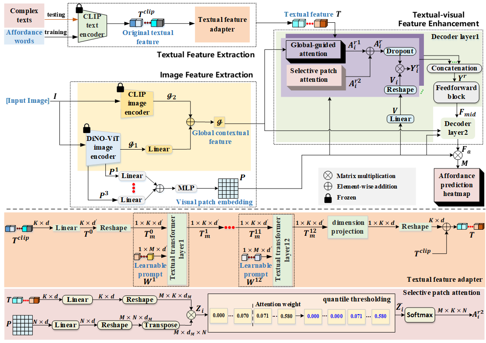
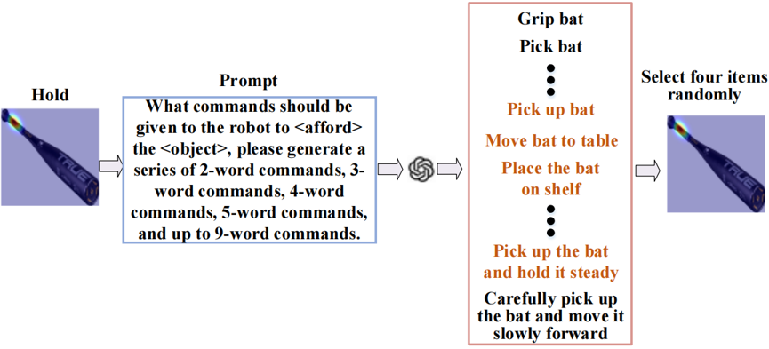

# OpenDI

OpenDI is a one-shot open-vocabulary affordance detection method with textual–visual dual interaction. Two parallel branches enhance the correspondence between textual and visual features: a selective patch attention branch uses quantile thresholding to suppress weakly correlated responses, while a global-guided attention branch uses global contextual features from the DiNO-ViT and CLIP image encoders to guide foreground enhancement. A Transformer-based textual feature adapter, placed after the frozen CLIP text encoder, incorporates independently optimized, layer-specific learnable vectors to capture salient affordance information in semantically dense texts.

This repository provides the test texts for the semantically-expanded versions of the AGD20K and UMD testing sets and describes the text selection procedure to facilitate reproducibility.

## Pipeline

*Figure 1. The overview of the proposed one-shot open-vocabulary affordance detection network with textual-visual dual interaction, which takes affordance-related text and a given image as inputs to ground the object component-level regions.*

## Test texts

- [AGD20K](AGD20K%20semantically-expanded%20test%20texts.xlsx)
- [UMD](UMD%20semantically-expanded%20test%20texts.xlsx)

Each row contains an object category, an affordance category, and four test texts. The expanded texts replace the original affordance words, while the corresponding test images and ground-truth region annotations remain unchanged.

## Text generation and selection procedure

ChatGPT-4 is prompted to generate candidate texts for each affordance–object pair using the following prompt:

> What commands should be given to the robot to `<afford>` the `<object>`, please generate a series of 2-word commands, 3-word commands, 4-word commands, 5-word commands, and up to 9-word commands.

Here, `<afford>` and `<object>` are replaced with the corresponding affordance and object labels. Four manually screened texts are retained for each pair. Texts are retained only when they preserve the target affordance and refer to interaction regions consistent with the original ground-truth annotations. Texts that change the intended action or do not clearly specify an interaction compatible with the annotated region are discarded.

*Figure 2. An example of semantic expansion for an affordance–image pair in the AGD20K testing set.*

Examples of discarded texts include:

| Discarded text              | Reason for exclusion                                                                                                     |
| --------------------------- | ------------------------------------------------------------------------------------------------------------------------ |
| Stop moving                 | Does not specify a target object or an interaction region corresponding to the target affordance.                        |
| Detect the bat using vision | Describes visual detection rather than an interaction corresponding to the annotated affordance region.                  |
| Rotate hammer               | Describes a different action and does not clearly identify the interaction region associated with the target affordance. |

The expanded texts are intended to evaluate robustness to unseen textual expressions of the target affordances. Semantic expansion alone does not introduce new affordance categories. Manual screening preserves the applicability of the original annotations but does not eliminate linguistic biases from LLM generation or selection biases from human review.

## To-do list

- [ ] Release AGD20K test texts.
- [ ] Release UMD test texts.
